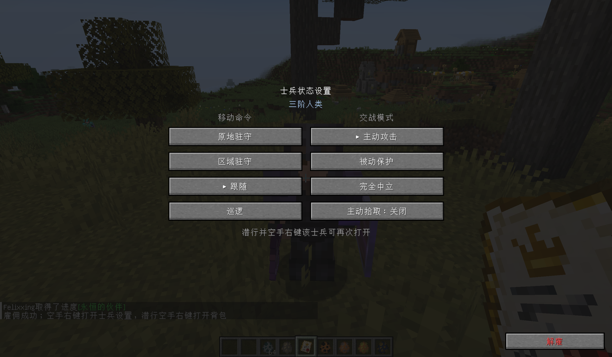
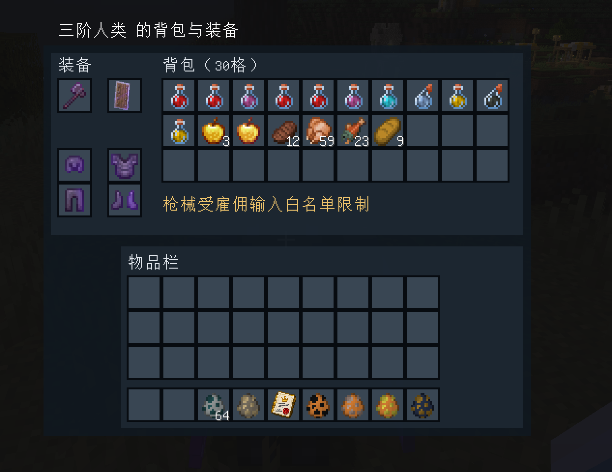

# Hostile Humans Unified

[简体中文](README.md) | [English](README.en.md)

由原模组 [Hostile Humans](https://www.curseforge.com/minecraft/mc-mods/hostile-humans) 修改衍生，整合 **Human Gunner** 的相关内容，并加入原创玩法。这是一个可独立安装的 Forge 模组，不需要另外安装原版 Hostile Humans 或 Human Gunner。模组强化了敌对人类的属性、战斗与生存机制，适合搭配其他模组或整合包游玩。模组的修改与构建过程使用了 GPT 辅助。

## 核心玩法

模组加入流浪者、一阶、二阶和三阶人类。不同阶级拥有不同的属性、装备与战斗能力。人类会根据身份牌和阵营关系决定如何对待玩家：敌对、保持中立，或成为玩家的保护者。

玩家可以使用合同雇佣人类，并通过对讲机管理名册。已雇佣的人类可以设置跟随、区域驻守、原地驻守、巡逻或贴身保护，并选择主动攻击、许可攻击、被动保护或完全中立。玩家还可以打开士兵背包，管理武器、护甲和其他装备，调整主动拾取设置，或解除雇佣。

跟随士兵会随距离加速追赶。主人下线后，跟随中的士兵转为当前位置的区域驻守，保留原攻击模式；离线期间死亡的士兵会在主人下次上线时报告死亡原因与地点。

人类会根据装备使用近战武器、盾牌、弓、弩、三叉戟或枪械。低血量时会撤退并尝试恢复；远程单位会寻找攻击位置，近战单位会追击目标。信号弹可以召来临时援军或敌对人类；对讲机可查看士兵状态并召回他们。

弓弩统一消耗本模组的人类箭矢（每组64）；每次弓射击或弩齐射消耗1支，多重射击按一次齐射计费。TaCZ 枪械换弹消耗通用弹匣（每组24）：手枪／冲锋枪1、步枪／霰弹枪2、狙击枪3、机枪4、重型武器5。弹匣不足时不能换弹；枪内剩余子弹仍可射击。弹药耗尽后优先使用有箭矢的弓弩，否则使用现有近战武器；补给放入士兵背包即可恢复可用远程武器。三叉戟保持无限投掷。

闲置时只有弹匣内剩余弹药严格低于容量的25%才换弹，等于25%不触发；例如30发弹匣剩7发会换弹，剩8发不会。战斗中只在打空后换弹，若膛内仍有一发，会先打完该发。阈值判断及弹匣费用统一在换弹入口执行。

工作台无序合成：4支原版箭＋1根木棍＋1根羽毛→32支人类箭矢；3份火药＋2个铁锭→2个通用弹匣。弹匣配方仅在安装TaCZ时加载。

新生成的相应职业按阶级携带初始补给：流浪者32–128支箭／6–12个弹匣，一阶64–128支箭／12–24个弹匣，二阶128–192支箭／32–48个弹匣，三阶192支箭／48–72个弹匣。同时持有两类武器时分别配给；生成时的首仓枪内子弹不另扣弹匣。旧存档单位需自行补给，不因重新加载或雇佣而自动补满。这两种弹药仅供人类使用，普通玩家弹药不能替代。

## 模组兼容

- **TaCZ**：可选枪械兼容。枪手可使用枪械；无需 Player Animator 也能显示持枪、瞄准和基础换弹／射击动作。安装 Player Animator 且枪包提供相应资源时，使用枪包的第三人称关键帧动画。
- **Better Combat**：可选近战兼容。士兵可使用其攻击冷却、攻击范围与范围攻击；未安装时自动使用模组自身的战斗逻辑。兼容开关可在配置文件中调整。
- **Curios**：可选饰品栏兼容，可将身份牌放入专属身份牌栏位。
- **Spartan Weaponry、Spartan Shields、Immersive Armors**：安装后自动识别兼容武器、盾牌和盔甲，无需额外配置。

这些都是可选兼容模组，不是本模组的运行依赖。

## 界面预览

**士兵命令面板**

**士兵背包与装备**

## 安装与配置

适用于 Minecraft 1.20.1 Forge。将统一版 JAR 放入实例的 `mods` 文件夹即可；不要同时安装独立的 Hostile Humans 或 Human Gunner JAR。

配置位于 `config/hostile_humans_unified/`，由 global.json 和 roamer/tier1/tier2/tier3.json 五个文件组成，各阶独立设置属性、AI、装备和出生弹药；全局管理总开关与共享规则，保留中英文说明。旧 JSON 与原 TOML 会自动迁移并保留备份，不重置自定义设置。可调整分阶解锁日期、随日期成长的装备品质、四阶装备池、属性与散布、战斗行为、雇佣费用及枪械名单等。装备自定义直接使用配置文件，不再使用旧装备数据包。完整说明见[配置文件指南](CONFIGURATION.md)。多人游戏以服务器配置为准。

## 许可证与来源

本模组统一发行版使用 GNU GPL v2.0，完整文本见仓库根目录 [`LICENSE`](LICENSE)。整合自 Human Gunner 的源码保留原有 MPL-2.0 声明，并在 MPL-2.0 允许的范围内作为较大 GPL 作品的一部分同时按 GPL 条款发布。组件来源及许可说明见 [`THIRD_PARTY_NOTICES.md`](src/main/resources/THIRD_PARTY_NOTICES.md)。

全局 `global.json` 中的 `equipment_integration.auto_import_enabled` 是武器装备自动导入总开关，默认 `true`（旧文件缺少该项也按开启读取，可手动添加此配置组）。设为 `false` 后，启动不再导入或改写装备池，已有条目仍可使用。斯巴达武器和盾牌还分别受各阶自动导入开关控制。安装对应模组后，启动时会将已注册装备追加到各阶尚未导入的非空装备池，保留玩家自定义条目及权重；即使配置先于物品注册表生成，也会在注册表就绪后重试。已有阶级文件导入前会生成 `.pre-equipment-import-*.bak` 备份，并保留自定义属性和说明。空池、关闭自动导入的池，以及保留 `_imported_spartanweaponry` / `_imported_spartanshields` 导入记录后删除的装备不会自动补回；导入只影响随后生成的人类。

装备池默认含原版装备。可以删除原版条目并填写已注册的自定义装备；保留数组键，用 `[]` 表示空池。主手池无可用条目时仍有安全近战回退，远程池无可用条目时仍有弓回退；护甲、盾牌和备用武器的空池不补默认装备。希望出生装备严格使用自定义池时，关闭自动导入及全局 `equipment_growth.enabled`，并按需关闭各阶 `equipment_loadout.allow_tacz_firearms`，以免额外配枪或成长替换影响最终装备。
