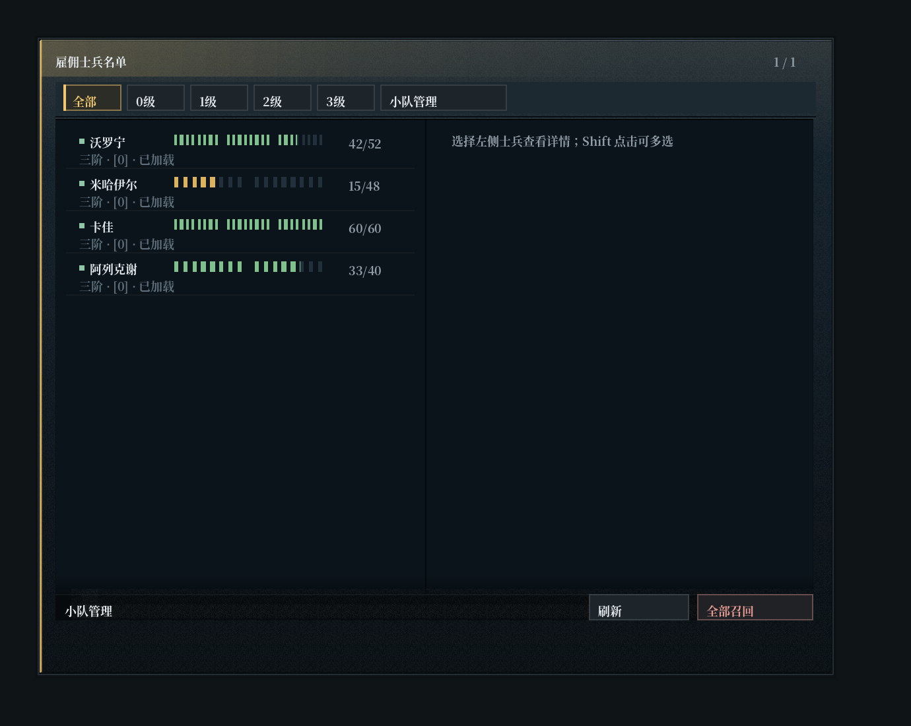
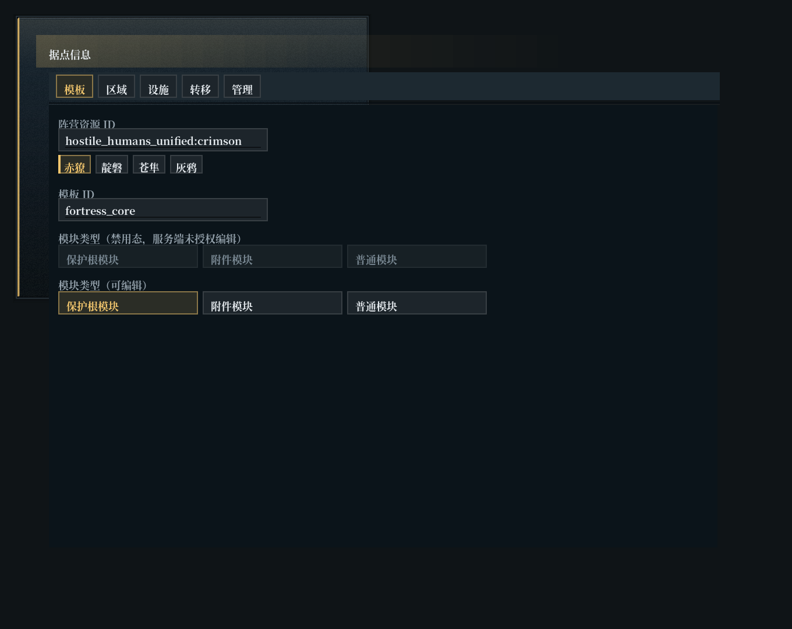

# 统一界面框架（client/ui/framework）

本文件说明界面总览（`界面总览.html`）与源码之间的对应关系、公共接口、已知差异和后续迁移顺序。设计依据仍是维护目录里的参考页与概念图；本文件不替代参考页。

## 一、依据与素材

- 参考：`E:\MC\Create-Delight\HostileHumansUnified-维护\界面总览.html`（13 个界面，4 阵营 × 4 尺寸，含视觉基线全部细节）。
- 实现：`src/main/java/dev/felix/hostilehumans/client/ui/framework`。
- 素材同源核对：仓库 `textures/gui/panel/surface.png` 与参考页内嵌噪点图 SHA-256 完全一致；四枚阵营徽记与参考页内嵌徽记同尺寸同源。
- 本轮从参考页补入 5 个 16×16 分组刻符：`textures/gui/icon/{move,guard,range,fight,prefer}.png`，均为纯白 alpha 蒙版，由主题强调色着色，不含烘焙颜色。

## 二、参考元素 → 公共组件 → 使用页面

| 参考元素 | 实现位置 | 使用页面 |
|---|---|---|
| 面板骨架：3px 圆角、2px 切角、1px 暗描边 + 3px 灰环、四段竖向渐变、内侧受光、柔和投影 | `UiDraw.frame` / `UiDraw.shadow` | 全部面板页 |
| 左侧阵营饰条（3px，透明度 .8） | `UiDraw.spine`（由 `frame` 调用） | 全部面板页 |
| 独立顶栏带（28px 强调渐变）+ 徽记徽章 14×18 + 右侧状态 | `PanelScreen.render` / `headerStatus()` | 全部面板页 |
| 顶栏下分割线（1px 暗 + 1px 亮） | `UiDraw.rule` | 全部面板页 |
| 过滤底带（24px，top 32） | `PanelScreen.buildBand()` / `bandStatus()` | 对讲机 |
| 分组底带（刻符 + 8px 图标 + 渐隐下划线） | `UiDraw.groupBand` / `PanelGroup` | 单兵命令、小队命令、对讲机 |
| 内凹内容区（#0B141A + 内阴影 + 1px 暗描边） | `UiDraw.shelf` | 全部面板页 |
| 固定底部操作台（黑色底衬 + 5px 晕影 + 内侧亮线） | `UiDraw.actionBar` / `PanelScreen.footerSpacer()` | 全部面板页 |
| 内容底部渐隐（12px） | `UiDraw.fade` | 全部面板页 |
| 主从双栏、1px 分隔线、两栏独立滚动 | `PanelGeometry.split` / `PanelScreen.buildLeft|Right` | 对讲机 |
| 按钮：常态 / 悬停 / 选中（含左侧 2px 条与呼吸）/ 禁用 / 危险 | `UiDraw.control` / `PanelButton` | 全部面板页 |
| 勾选行（8×8 方框） | `UiDraw.checkbox` / `PanelCheck` | 单兵命令、小队命令 |
| 短滑轨（标签左、数值右、3px 轨道、6×9 滑块） | `UiDraw.track` / `PanelSlider` | 单兵命令 |
| 分段进度条（高 4，每 8px 一条 1px 分隔） | `UiDraw.meter(segmented)` / `PanelMeter` | 单兵命令、小队命令、对讲机 |
| 细胞血条（8 tick/格，上限8格，按实际生命比例填充及换色） | `UiDraw.health` / `PanelHealth` | 单兵命令、小队命令、对讲机 |
| 名单行（状态点、姓名列、血条列、数值列、第二行元数据、选中/离线态） | `PanelRosterRow` | 对讲机 |
| 阵营主题：强调色 + 徽记 + 顶栏晕染比例 | `UiTheme` / `UiThemes` / `gui/theme.json` | 全部面板页 |
| 低强度噪点（64px 平铺） | `UiDraw.grain` | 全部面板页 |
| 阵营水印 | `UiDraw.watermark` | 全部面板页 |

## 三、与参考一致的尺寸

- 面板：S 400×420、S+ 420×520、M 600×480、L 720×540（`PanelGeometry.Size`）。
- 水平边距：左 12、右 14；标题带 28；过滤带 top 32、高 24；内容区下边距 40；操作台高 20、距底 10。
- 控件：按钮高 20、左右内边距 7；所有控件 1px 描边。
- 血条：每大格 8 根细刻度（`PanelGeometry.TICKS_PER_CELL`），tick 宽 1px（头部 2px），刻度间 1px，格间 3px（4px），高 8px（9px）。整条恒等于该单位的最大生命，因此满血一定画满；大格只是视觉分组，不再代表固定 25 点。名单行内血条固定占 112px 列，所有行左端对齐。
- 分段进度条：高 4px，填充每 8px 断开 1px。
- 滑轨：轨道 3px，滑块 6×9。

## 四、本轮修复的绘制缺陷（先查原因再改）

1. **白色噪点**：`UiDraw.frame` 把 64×64 的 `surface.png` 整块拉伸到面板尺寸，噪点被放大成白斑；改为 64px 平铺，并按参考页 `opacity:.30` 设置着色。
2. **徽记比例失真**：96×96 徽记曾按 96×120 绘制（纵向拉伸），顶栏徽章按 12×16 绘制（横向压扁）；现固定为等比（徽章 12×12、水印 86×86）。
3. **绘制状态污染**：`setColor` 只用于贴图着色（噪点、徽记、水印、刻符），全部 `try/finally` 复位；其余颜色一律用 `UiColor` 预混，不依赖 GL 状态传递。
4. **投影偏移**：原先依赖 `shadow.png` 九宫格拉伸且上下偏移不对称；改为程序化分层柔影，位置确定、无拉伸。

## 五、已知差异（无法在 Minecraft 原生渲染下完全还原）

1. **字号**：参考正文 9px、次级信息 8px。Minecraft 原生字体只有一档 9px，次级信息改用同字号 + 弱化颜色 + 10px 行距表达层级。未使用 pose 缩放，避免中文笔画发糊。
2. **圆角与切角**：CSS 为真圆角 + 斜切多边形；这里是逐行像素阶梯近似（半径 3、切角 2）。
3. **渐变**：CSS 为逐像素插值；面板竖向用 3 段 `fillGradient`，顶栏横向用 26 段阶梯，肉眼可见轻微分层。
4. **过渡与动效**：没有缓动曲线；选中呼吸为 2.8s 正弦，且受 `gui/theme.json` 的 `animation` 开关控制（关闭后为常亮）。
5. **水印**：参考页中水印因层叠顺序被内容区遮住；实现中放在内容区底层（α=.14），以保证暂定基线第 25 项「阵营水印」可见。
6. **滚动条**：使用面板内自绘 2px 滚动条，不是浏览器原生样式。
7. **中文宽度**：MC 全角字形固定 9px，浏览器 9px 中文字形宽度略有出入；长名称按像素裁剪而非省略号。

## 六、公共接口

框架层（`client/ui/framework`）：

- `UiTheme`：只读主题记录；除基础色外全部由 `UiColor` 派生（选中/禁用/危险/底带/操作台/轨道等），阵营只需提供强调色。
- `UiThemes`：`faction(id)`、`colored(accent)`、`emblem(id)`、`marker(name)`、`animation()`；`MARKER_*` 为 5 个分组刻符。
- `UiDraw`：`frame`、`shadow`、`spine`、`grain`、`headerBand`、`shelf`、`actionBar`、`fade`、`groupBand`、`control`、`checkbox`、`track`、`meter`、`health`、`badge`、`watermark`、`scrollbar`、`rule`、`ruleFade`、`rect`、`outline`、`roundRect`。
- `PanelScreen`：新增 `headerStatus()`、`buildBand()`/`band()`/`bandStatus()`、`splitWidth()`/`buildLeft()`/`buildRight()`、`footerSpacer()`、`node(...)` 全部控件重载；原有 `buildContent()`、`footer()`、`text()`、`field()`、`node()`、滚动与焦点契约保持不变。
- 控件：`PanelGroup`、`PanelCheck` 为新增；`PanelButton`（含 `sheen()`）、`PanelRosterRow`、`PanelHealth`（`heading()`）、`PanelMeter`（`segmented()`）、`PanelSlider`（`value()`）、`PanelPageSlider`、`PanelEditBox`、`PanelText`、`PanelDisclosure` 接口向后兼容。

页面层不得再自绘边框、底带、血条、滑轨或底色；阵营差异只经主题表达。

## 七、迁移状态

- 已迁移：单兵命令（`CommandPanelScreen` + `SoldierCommandScreen`）、小队命令（`SquadCommandScreen`，继承单兵底座）、对讲机（`SoldierRosterScreen`）、属性详情、巡逻等待、导航图例、经济（页签改到过滤带）、据点（页签改到过滤带）、背包容器页（三块分区 + 24px 槽位，槽位位置由界面层指派，菜单与校验不动）、监视器 HUD（360×62 半透明板 + 3px 阵营饰条）。
- 仅继承外壳、未逐项重排：培养页（单流程表单，没有页签结构，暂未改布局）。
- 注意工作目录：main 已在本会话期间前进（主控合入第一轮并修了 `UiRect.inset(h,v)`、`split` 空体保护、单栏 `revealFocus` 偏移、贴图混合状态、滑块渲染可见性）。第二轮提交 `71e5264` 基于 `da7cd76`，未回退这些修复。
- 新增公共件：`PanelKeyValue`（只读标签/数值行）、`PanelGroup`（分组底带）、`PanelCheck`（勾选行）、`PanelButton.compact()`（标签尺寸控件）、`PanelDisclosure` 改为参考行样式（左标签、右数值、展开明细）。
- 尚无客户端界面的参考页：人类对话（`SoldierDialogue` 只有文本派发，没有客户端界面与网络协议；实现需要新增协议，超出界面任务范围，待主控决定）。

## 八、问题分析与改法（2026-11-03 分析；同日已按下列方案修复，见 8.4）

下列两张图是按 `UiDraw` / `PanelScreen` / `PanelEditBox` 的实际取色与几何**逐条重放**出来的诊断图（脚本重写，不是游戏截图），用来对齐讨论位置；它们能反映颜色与间距，但字体度量按 9px 中文字形近似。生成脚本在 `maintenance-tools/ui-preview/`，改完绘制层后可以重跑对比。

### 8.1 据点信息方块：选项文字"看不见"

渲染路径：`SettlementScreen.buildContent()` → `identity()` → `input("faction", …)` 走 `PanelScreen.field()`；选项行走 `action(...)` → `PanelButton`。三个候选原因，按可能性排序：

1. **选中/可编辑态的对比度不足（最可能）**。`action()` 里 `b.active = editable()`，而 `editable()` = 作者 && 已知结构 && 无待确认。一旦不满足，`UiDraw.control` 走 `disabledFace()` = `mix(inset, 白, .022)`（几乎等于内容区底色 #0B141A），文字走 `t.disabled()` #5F707C，实测对比度约 3.4:1，在噪点底上读不出来；点中之后文字转成 `accent()` 才"突然出现"。判别：同一屏里如果别的行（如"模块类型"可编辑分支）文字清楚，就是这条。
   改法：`disabledFace()` 改成 `mix(inset, 白, .05)` 并给 1px `disabledEdge()` 描边；禁用文字改用 `muted()` 的 70% 而不是 `disabled()`；另外把"不可编辑"和"未选中"分开——未选中但可编辑时文字用 `text()`（现在是这样），不可编辑时至少保留 `muted()` 级可读性。

2. **构建早于文字惰性折行修复**。`PanelButton` / `PanelText` 的文本只在被测量时折行；3.14.3（`71e5264` 之前）任何没经过 `measureHeight` 的按钮都会整块空白。判别：如果那一屏所有按钮都没字，而不只是禁用项，就是这条。3.14.4 之后应已消失。

3. **`PanelEditBox` 内框只有 8px 高**。`place()` 把 20px 槽位缩成 `height-12`，原版 `EditBox` 的 scissor 按自身高度裁剪，9px 字形会被切掉 1 行（不明量级，但会显得"字被削顶"）。改法：内框高度取 `max(12, b.height - 10)`，或干脆保留 20px 高度、只把描边画在外面。

确认方式：截一张该方块打开后的画面（含阵营那一行和下面的选项行）。若是第 1 条，图上会看到"灰底上极暗的字"；若是第 2 条，则整块空白。

### 8.2 底部操作台和背景噪点"割裂"

三处硬边叠在一起：

- `UiDraw.actionBar` 的 5px 外圈是 `alpha(黑, .34)` 的**实心矩形**，在渐变频点上直接压出一个硬边黑框；
- 操作台填充 `actionBar()` = `mix(bottom, 黑, .34)` 是**不透明**色，把 64px 噪点整块切断；
- `UiDraw.fade` 从透明渐变到 `t.inset()` 的**完全不透明**，于是内容区底部出现一条 12px 的"死平"色带。

改法（三条都很小）：
1. 去掉 5px halo，换成 10~12px 的竖向渐变遮罩（透明 → 黑 .34），让它融进面板渐变；
2. 操作台填充改成半透明（α≈.72）或 `mix(bottom, accent, .04)` 再压一层 12% 黑，让底下的噪点透出来；
3. `fade` 别收到 1.0，收到 .85 即可，并把起点从 12px 抬高到 20px；
4. 统一做法：在 `actionBar` 与 `fade` 画完之后**补一遍 `grain()`**（只覆盖底部条带），噪点在所有装饰上保持连续——参考页里噪点层本来就在控件之下、背景之上。

### 8.3 预设表单（阵营等）

现状：`identity()` 把阵营做成自由文本 `input("faction", faction)`，玩家要手打 `hostile_humans_unified:crimson`。

建议：加一个 `PanelChoice` 小控件（当前值 + 一排候选块 + "自定义"）。候选来自 `gui/theme.json` 的 `factions` 键——`UiThemes` 已经解析过这份数据，只需补一个只读访问器 `UiThemes.factions()`，属于界面内接口，不动协议。选中后仍然往同一个 `InputValue<String>` 里写、提交同一个字符串，服务端校验与快照格式都不变；自定义仍可手输。真正由服务端下发"本据点允许哪些阵营"属于协议扩展，需要主控决定，本轮不做。

同一屏其余适合改成预设/步进的字段：`tier`（整数档位）、`size`/`origin` 的六个数（步进 + 直接读数）、`kind`（已有 `choices`，可复用成同样的视觉）。

### 8.4 本轮已实施（2026-11-03）

- **禁用态可读性**：`UiTheme.disabledFace()` .022 → .05 白，`disabledEdge()` .05 → .10，新增 `disabledText()`（`disabled` 与 `muted` 各半，禁用面约 5:1）。`PanelButton` / `PanelCheck` 的禁用标签改用 `disabledText()`。据点表单里"选不了"的选项现在读得出来，但仍明显是灰的。
- **输入框字形被裁**：`PanelEditBox.place()` 内框高度 `height-12`(8px) → `max(12, height-8)`，外框仍占满 20px 槽位；原生 scissor 不再削掉字底。
- **底部割裂**：`UiDraw.actionBar` 去掉 5px 实心黑框，改成 14px 竖向渐变遮罩（`UiDraw.SCRIM`）；填充改半透明（`actionBar()` α .86）；`fade` 高度 12→20、末端 1.0→.85；`PanelScreen` 在操作台画完后按面板原点**补一遍 `grain()`**（新增带 origin 的重载），噪点在底部保持同相位连续。
- **预设表单**：`PanelScreen.field(label, draft, presets, presetLabel)` 在输入框下加一排预设块，点击直接写入同一个 `InputValue`（仍走 `setValue` → 走 responder → 走原有校验与提交）。`UiThemes.factions()` 只读暴露 `theme.json` 里的四个阵营 id；据点表单的"阵营资源 ID"已接入，标签取 `command.faction_name.*` 的本地化名，未知 id 回退到路径名。协议、快照与校验未变。
